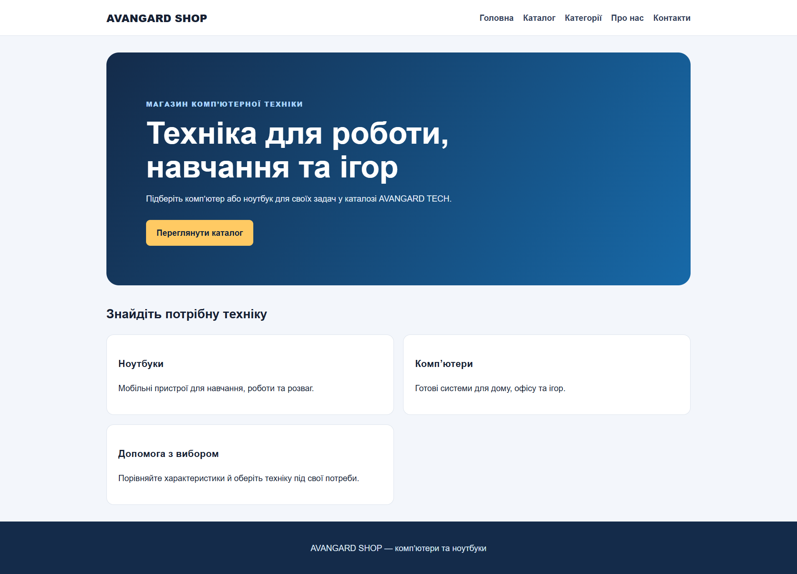
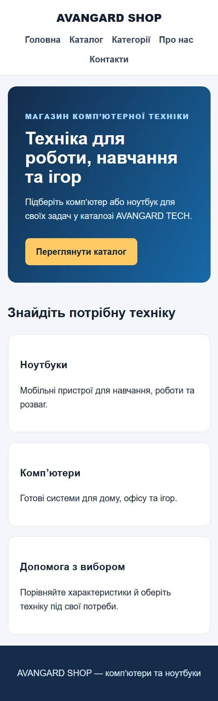
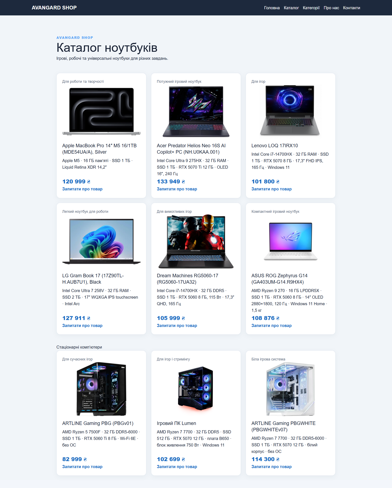
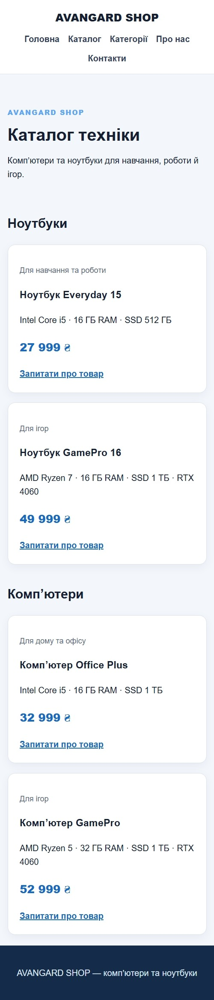
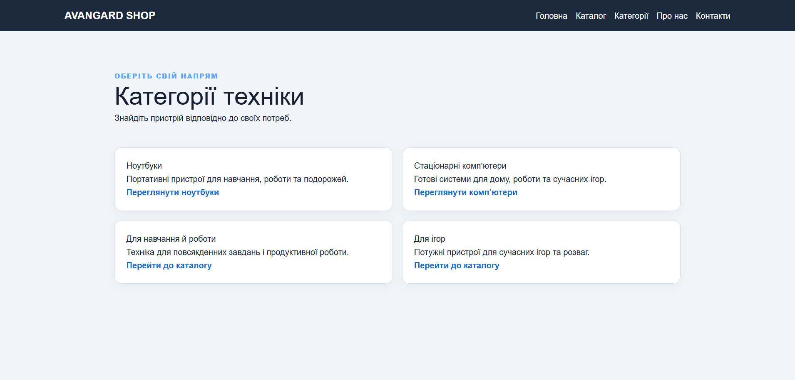
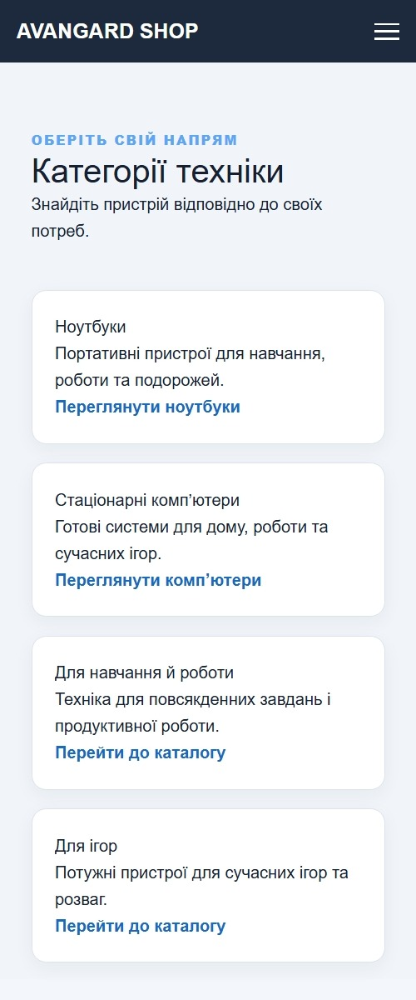
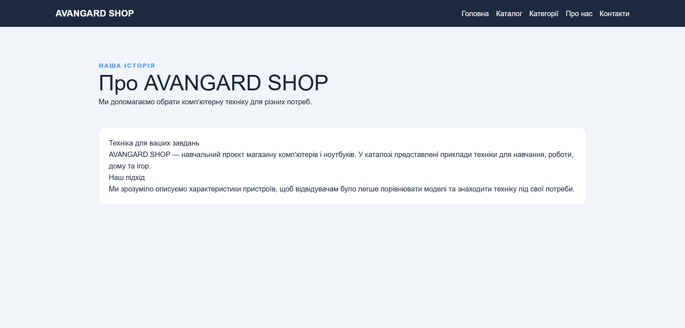
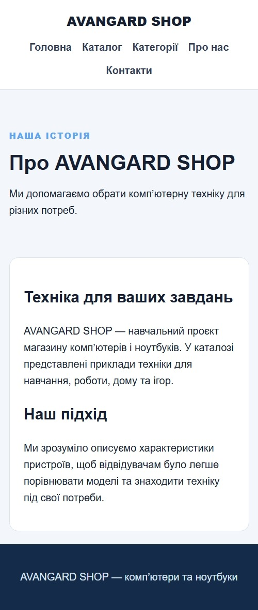
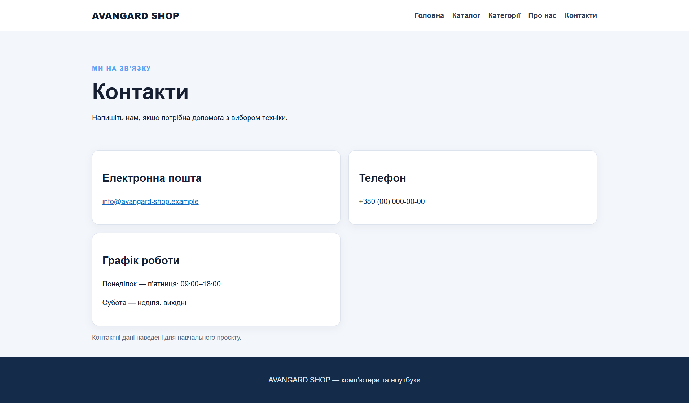
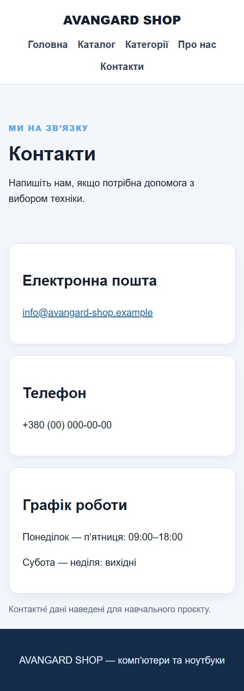

# Лабораторна робота №3 — звіт

## Загальна інформація

- **ПІБ:** Грицюк Назар Олександрович
- **Група:** ІПЗ-22
- **Роль у команді:** Developer
- **GitHub-акаунт:** [SkyDreammer-exe](https://github.com/SkyDreammer-exe)
- **Склад команди:**
  - Шульга Андрій Сергійович (Teamlead) — `shulgaaa294-stack`
  - Грицюк Назар Олександрович (Developer) — `SkyDreammer-exe`
  - Смоляр Орест Миколайович (QA) — `Mphizard`
- **Тема проєкту:** сайт продажу ПК та ноутбуків на Flask
- **Репозиторій:** <https://github.com/The-Avangard/lab-03>

## Особистий внесок у командну роботу

- створив початкові сторінки каталогу та категорій техніки;
- додав і оновив каталог ноутбуків із фото, характеристиками та цінами;
- додав до каталогу стаціонарні комп’ютери;
- підготував налаштування проєкту: `.gitignore` і `requirements.txt`;
- допомагав налагодити запуск Flask-застосунку в локальному середовищі.

### Мої коміти

| Хеш | Дата | Опис |
|---|---|---|
| [`f1a5679`](https://github.com/The-Avangard/lab-03/commit/f1a5679) | 30.10.2026 | Додано каталог і категорії техніки |
| [`6286378`](https://github.com/The-Avangard/lab-03/commit/6286378) | 30.10.2026 | Додано файли налаштувань проєкту |
| [`f4e799f`](https://github.com/The-Avangard/lab-03/commit/f4e799f) | 01.11.2026 | Update .gitignore |
| [`fd490ca`](https://github.com/The-Avangard/lab-03/commit/fd490ca) | 01.11.2026 | Create requirements.txt |
| [`c84b1cf`](https://github.com/The-Avangard/lab-03/commit/c84b1cf) | 01.11.2026 | оновив каталог |
| [`74ca554`](https://github.com/The-Avangard/lab-03/commit/74ca554) | 01.11.2026 | Оновив каталог стаціонарних пк |

## Скріншоти створених сторінок

### Головна сторінка

| Звичайний вигляд | Мобільний вигляд |
|---|---|
|  |  |

### Каталог

| Звичайний вигляд | Мобільний вигляд |
|---|---|
|  |  |

### Категорії

| Звичайний вигляд | Мобільний вигляд |
|---|---|
|  |  |

### Про магазин

| Звичайний вигляд | Мобільний вигляд |
|---|---|
|  |  |

### Контакти

| Звичайний вигляд | Мобільний вигляд |
|---|---|
|  |  |

## Труднощі та їх вирішення

- Під час запуску застосунку Flask не знаходився в обраному інтерпретаторі Python. Було створено віртуальне середовище проєкту, встановлено Flask у ньому та вибрано відповідний інтерпретатор.
- Для запуску застосунку потрібна мала літера в назві модуля: `from flask import Flask, render_template`. Після виправлення регістру імпорту застосунок запускається коректно.
- Для зображень товарів потрібно було налаштувати однакове відображення різних за форматом фото. Це вирішено стилями карток і зображень та адаптивними правилами для мобільних екранів.

## Висновки

Під час лабораторної роботи я долучився до створення Flask-сайту магазину ПК та ноутбуків і реалізував каталог товарів, категорії та файли налаштування проєкту. Команда навчилася працювати з GitHub, розподіляти задачі та перевіряти адаптивність сторінок. Надалі сайт можна розширити пошуком, кошиком і базою даних товарів.
