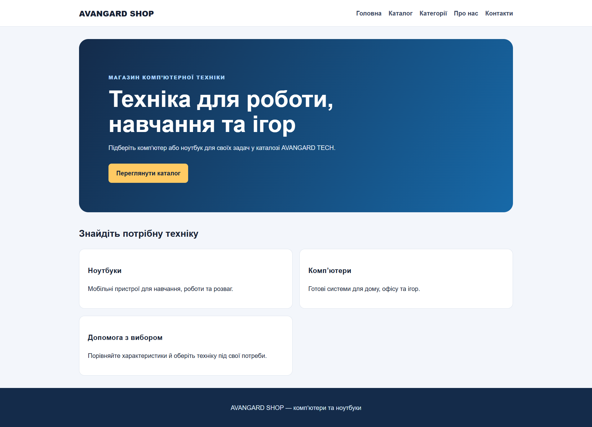
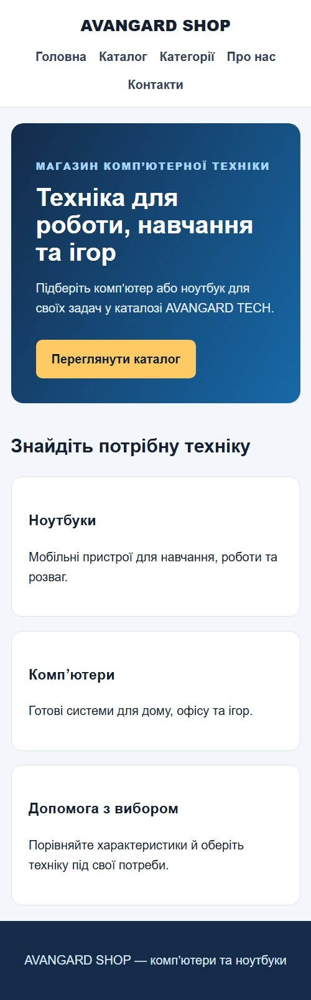
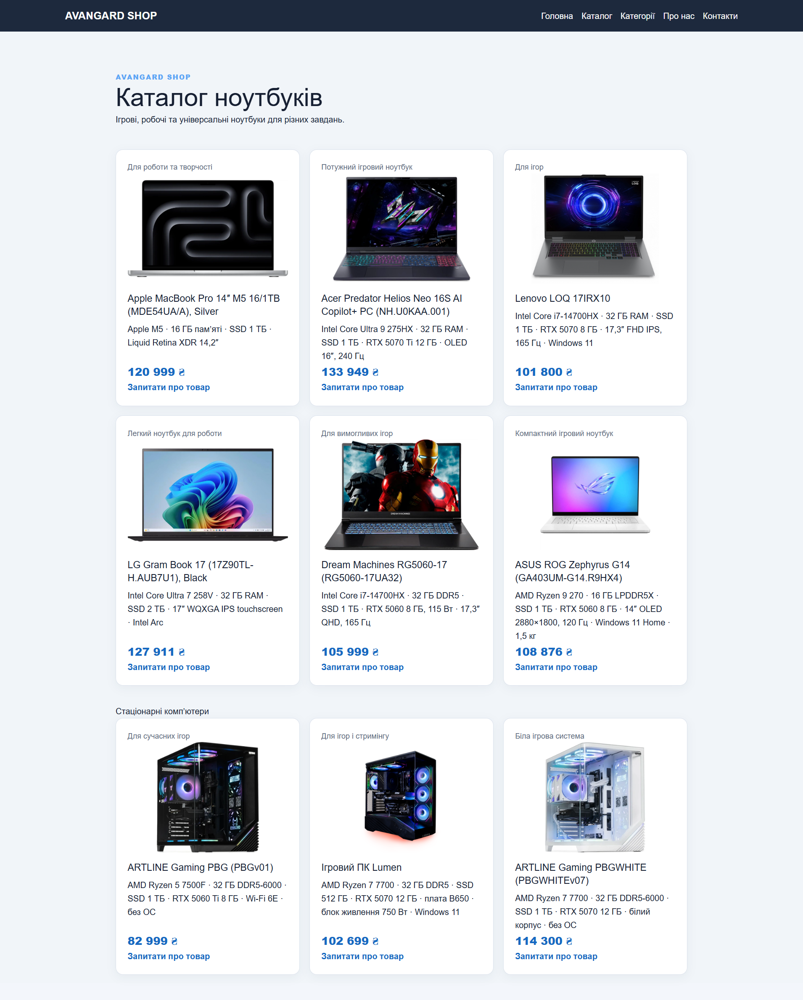
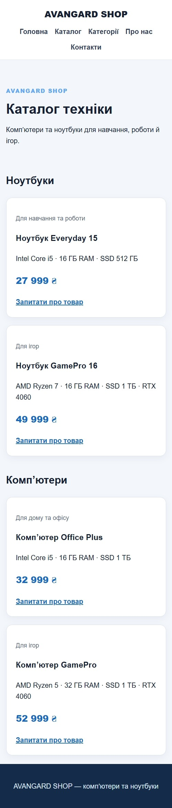
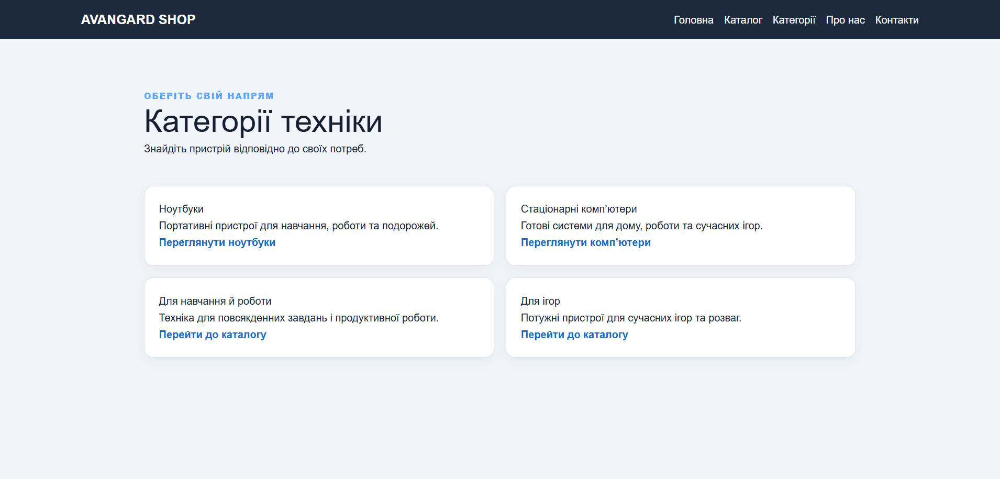
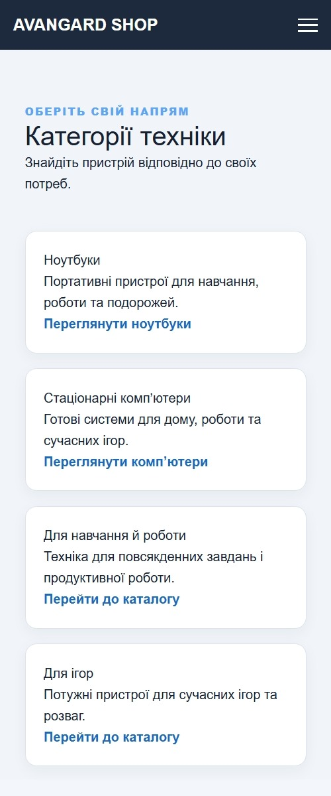
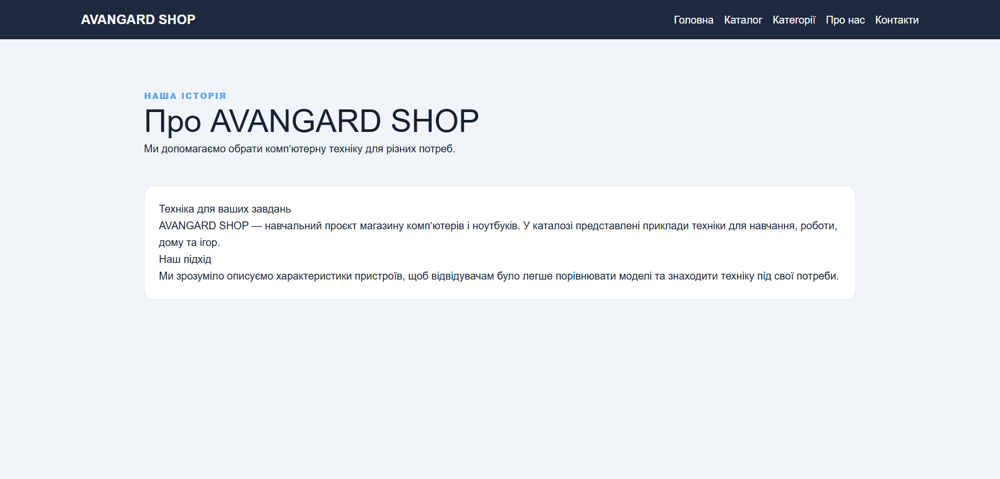
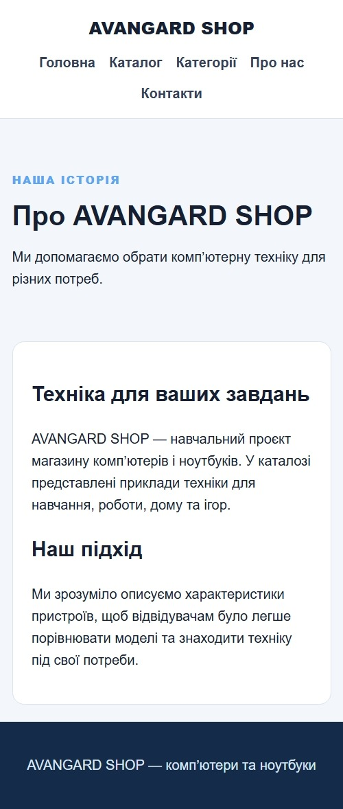
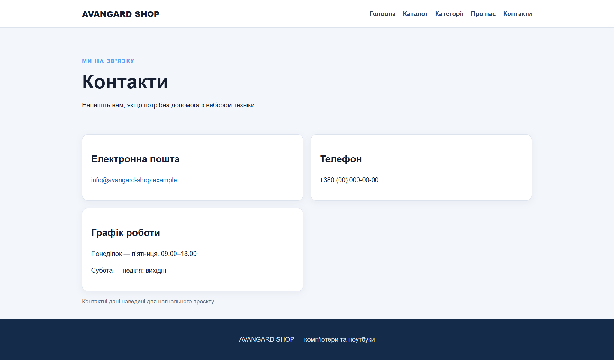
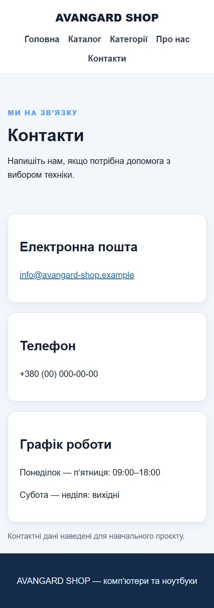

# Лабораторна робота №3 — звіт

## Загальна інформація

- **ПІБ:** Шульга Андрій Сергійович
- **Група:** ІПЗ-22
- **Роль у команді:** Teamlead
- **GitHub-акаунт:** [shulgaaa294-stack](https://github.com/shulgaaa294-stack)
- **Склад команди:**
  - Шульга Андрій Сергійович (Teamlead) — `shulgaaa294-stack`
  - Грицюк Назар Олександрович (Developer) — `SkyDreammer-exe`
  - Смоляр Орест Миколайович (QA) — `Mphizard`
- **Тема проєкту (предметна область):** сайт продажу ПК та ноутбуків (Flask)
- **Репозиторій:** <https://github.com/The-Avangard/lab-03>

## Особистий внесок у командну роботу

Що саме зроблено:

- створено репозиторій і початкову структуру проєкту;
- розроблено Flask-каркас застосунку (`app.py`) та головну сторінку;
- реалізовано маршрути каталогу та категорій товарів;
- створено файл основних стилів `static/css/main.css`;
- додано маршрути сторінок магазину («Про магазин», «Контакти»), які підключають шаблони, створені іншими учасниками;
- як Teamlead — розподіл завдань між учасниками та координація роботи над сторінками
-  до папки `screenshots` добавив скріншоти у звичайному та мобільному вигляді.

Мої коміти:

| Хеш | Дата | Опис |
|---|---|---|
| [`16398ac`](https://github.com/The-Avangard/lab-03/commit/16398ac) | 30.10.2026 | Initial commit |
| [`99467eb`](https://github.com/The-Avangard/lab-03/commit/99467eb) | 30.10.2026 | Створено Flask-каркас і головну сторінку |
| [`21787db`](https://github.com/The-Avangard/lab-03/commit/21787db) | 30.10.2026 | Додано маршрути каталогу та категорій |
| [`aa46600`](https://github.com/The-Avangard/lab-03/commit/aa46600) | 30.10.2026 | Create main.css |
| [`3c27ab3`](https://github.com/The-Avangard/lab-03/commit/3c27ab3) | 30.10.2026 | Додано маршрути сторінок магазину |

## Скріншоти створених сторінок

### Головна сторінка

| Звичайний вигляд | Мобільний вигляд |
|---|---|
|  |  |

### Каталог

| Звичайний вигляд | Мобільний вигляд |
|---|---|
|  |  |

### Категорії

| Звичайний вигляд | Мобільний вигляд |
|---|---|
|  |  |

### Про магазин

| Звичайний вигляд | Мобільний вигляд |
|---|---|
|  |  |

### Контакти

| Звичайний вигляд | Мобільний вигляд |
|---|---|
|  |  |

## Труднощі та їх вирішення

Адаптивність сторінок на мобільних екранах - додано адаптивні стилі та перевірено в режимі емуляції пристроїв у DevTools 

Скриншоти не вміщалися на один екран - для desktop я встановив розширення `GoFullPage - Full Page Screen Capture`, а для мобільного вигляду робив скріншот у режимі DevTools за допомогою Ctrl+Shift+S

У репозиторій потрапили зайві файли (кеш, локальні налаштування) - додано та оновлено `.gitignore` (`f4e799f`) 

## Висновки

під час лабораторної роботи наша команда створила сайт по продажу ноутбуків на Flask із такими сторінками як: `Каталог` `Категорії` `Головна` `Контакти` `Про нас`.Усі сторінки мають адаптивну верстку й коректно відображаються як на комп'ютері, так і на мобільних пристроях, що підтверджено скриншотами. Ми з командою розподілили завдання між ролями. В майбутньому ми плануємо добавити кошик та пошук товарів і підключення бази даних для товарів.
