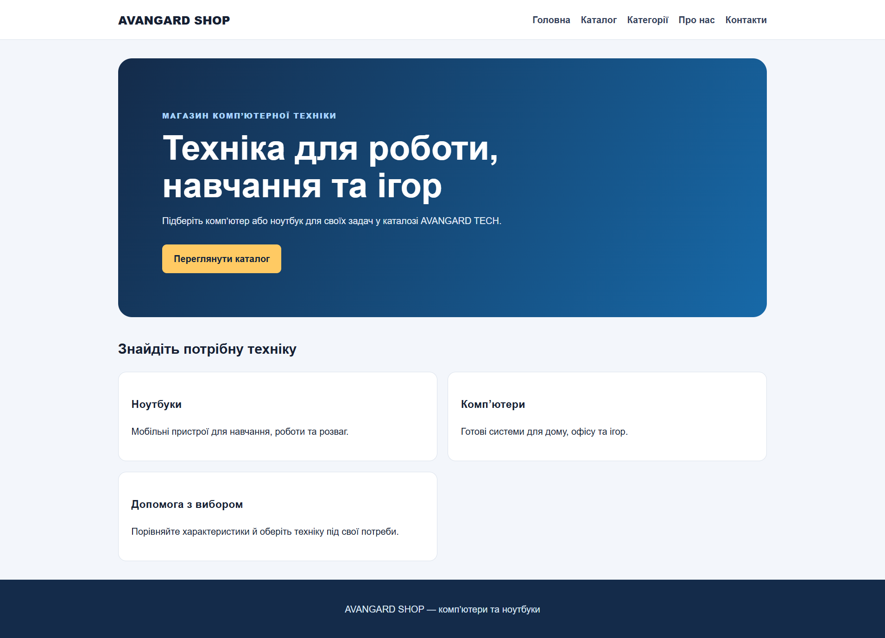
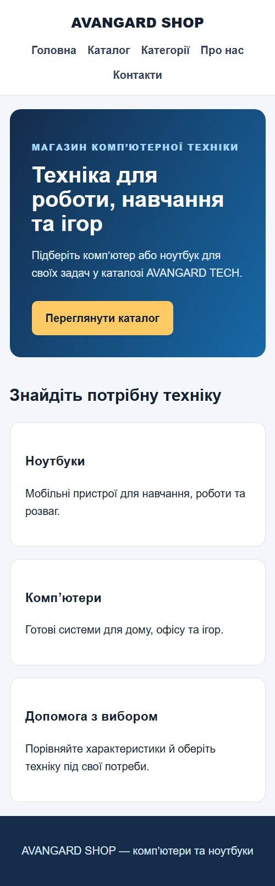
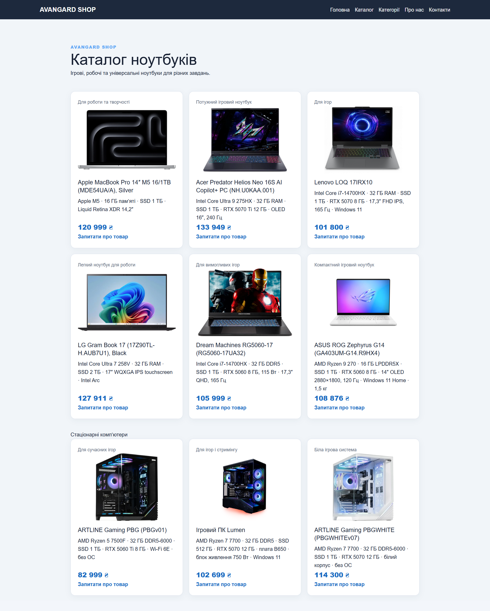
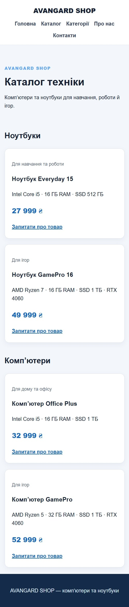
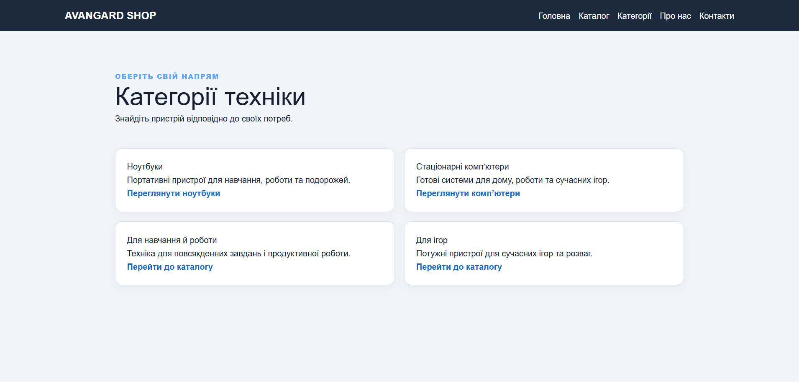
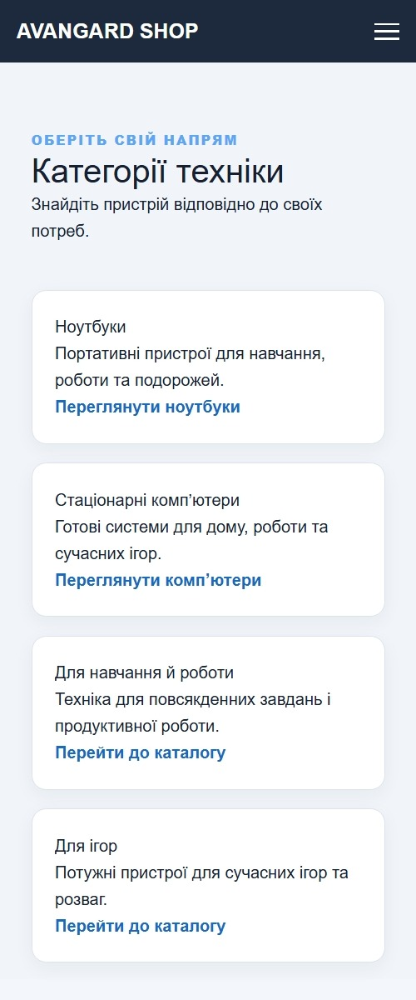
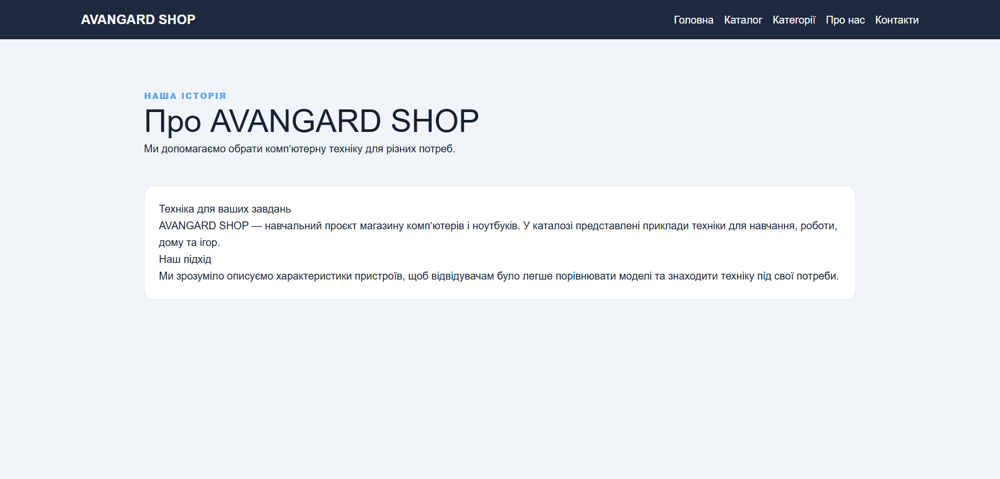
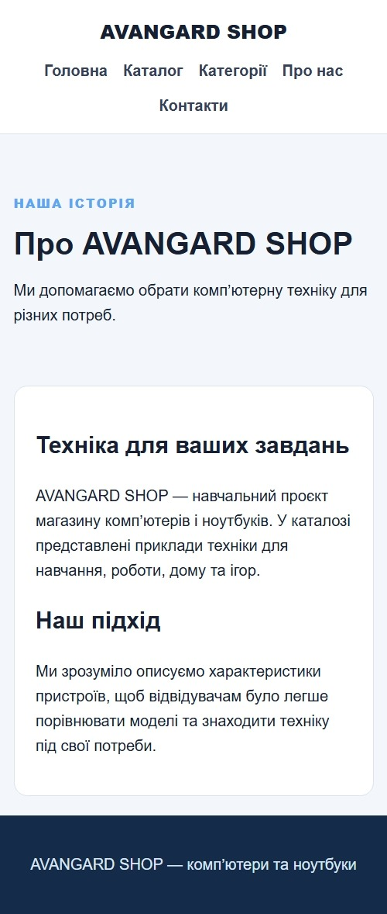
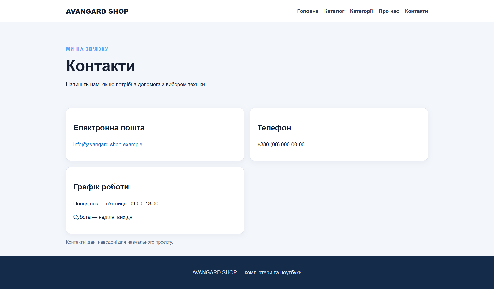
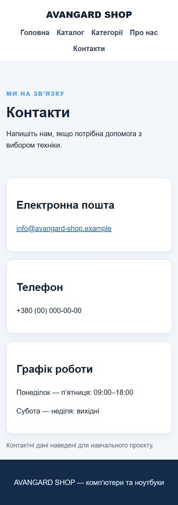

# Лабораторна робота №3 — звіт

## Загальна інформація

- ПІБ: Смоляр Орест Миколайович
- Група: ІПЗ-22
- Роль у команді: QA
- GitHub-акаунт: [Mphizard](https://github.com/Mphizard)
- Склад команди:
  - Шульга Андрій Сергійович (Teamlead) — shulgaaa294-stack
  - Грицюк Назар Олександрович (Developer) — SkyDreammer-exe
  - Смоляр Орест Миколайович (QA) — Mphizard
- Тема проєкту: сайт продажу ПК та ноутбуків на Flask
- Репозиторій: <https://github.com/The-Avangard/lab-03>

## Особистий внесок у командну роботу

- створив сторінки «Про магазин» і «Контакти»;
- розробляв і оновлював адаптивні стилі сайту;
- оновлював стилі та сторінку категорій;
- у ролі QA долучався до перевірки сторінок і їхнього відображення на різних розмірах екрана.

### Мої коміти

| Хеш | Дата | Опис |
|---|---|---|
| [fbabc5c](https://github.com/The-Avangard/lab-03/commit/fbabc5c) | 30.10.2026 | Додано сторінки про магазин і контакти та адаптивні стилі |
| [e9bc45c](https://github.com/The-Avangard/lab-03/commit/e9bc45c) | 30.10.2026 | Додано сторінки про магазин і контакти |
| [43bb023](https://github.com/The-Avangard/lab-03/commit/43bb023) | 01.11.2026 | Update categories.html |
| [f0d729f](https://github.com/The-Avangard/lab-03/commit/f0d729f) | 01.11.2026 | Update style.css |
| [e1c274a](https://github.com/The-Avangard/lab-03/commit/e1c274a) | 01.11.2026 | Update style.css |
| [e65de9e](https://github.com/The-Avangard/lab-03/commit/e65de9e) | 01.11.2026 | Update style.css |
| [0923954](https://github.com/The-Avangard/lab-03/commit/0923954) | 01.11.2026 | Update categories.html |

## Скріншоти створених сторінок

### Головна сторінка

| Звичайний вигляд | Мобільний вигляд |
|---|---|
|  |  |

### Каталог

| Звичайний вигляд | Мобільний вигляд |
|---|---|
|  |  |

### Категорії

| Звичайний вигляд | Мобільний вигляд |
|---|---|
|  |  |

### Про магазин

| Звичайний вигляд | Мобільний вигляд |
|---|---|
|  |  |

### Контакти

| Звичайний вигляд | Мобільний вигляд |
|---|---|
|  |  |

## Труднощі та їх вирішення

- Потрібно було забезпечити правильне відображення сторінок на вузьких екранах. Для цього додано адаптивні стилі та перевірено вигляд сторінок у режимі емуляції пристроїв у DevTools.
- Під час спільної роботи сторінки мали використовувати узгоджені стилі та навігацію. Стилі й категорії оновлювалися окремими комітами в репозиторії.

## Висновки

Під час лабораторної роботи я створив сторінки «Про магазин» і «Контакти», а також долучився до адаптації та перевірки сайту. Команда попрактикувалася в спільній роботі з Flask, Git і GitHub. Надалі сайт можна доповнити пошуком товарів, кошиком і базою даних.