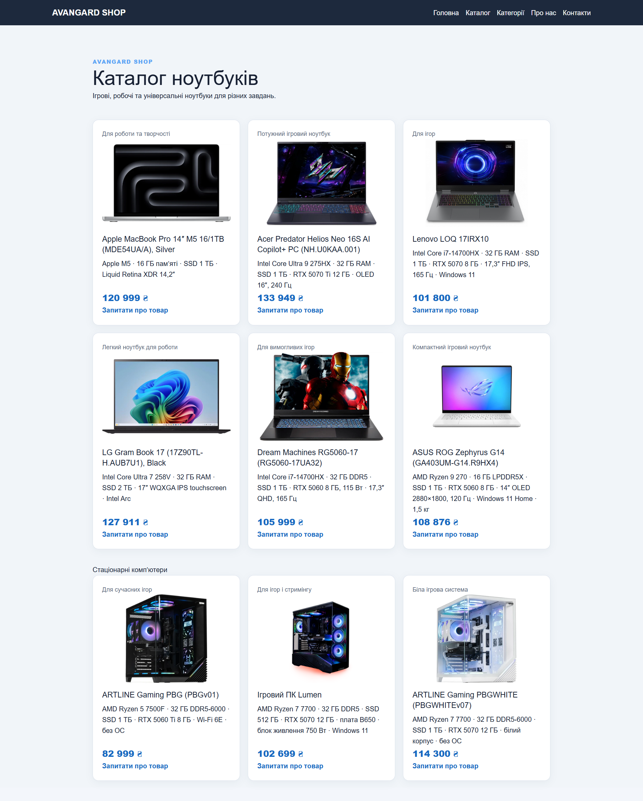

# Звіт з лабораторної роботи №03
## Розробка базового вебпроєкту

### Дані про студента
- **ПІБ:** Грицюк Назар Олександрович
- **Група:** [впишіть назву групи]
- **Студентський ID:** [впишіть справжній ID; після цього замініть `student-id` у назві файлу]
- **Тема проєкту:** AVANGARD SHOP — сайт магазину комп’ютерів і ноутбуків
- **Склад команди:** Шульга Андрій Сергійович, Грицюк Назар Олександрович, Смоляк Орест Миколайович

### Особистий внесок
Я створив сторінки каталогу техніки та категорій для сайту магазину. Також додав файли налаштувань проєкту `.gitignore` і `requirements.txt`.

Посилання на мої коміти:
- [Додано каталог і категорії техніки](https://github.com/The-Avangard/lab-03/commit/f1a56795bece79878b6105afc9706105f423d1d5)
- [Додано файли налаштувань проєкту](https://github.com/The-Avangard/lab-03/commit/62863788ea1cdf6a563c1dc5d85c9148beb3fd4a)
- [Оновлено `.gitignore`](https://github.com/The-Avangard/lab-03/commit/f4e799f96937b69cebabc742e2e964d959e81c10)
- [Створено `requirements.txt`](https://github.com/The-Avangard/lab-03/commit/fd490ca1f755895c48e06d480f37995f94a26874)

### Скріншоти сторінок
Збережіть скриншоти у `lab-reports/screenshots/` під зазначеними назвами. Зробіть їх для каталогу та категорій у звичайному й мобільному вигляді.

### Труднощі та їх вирішення
Під час запуску в новому віртуальному середовищі виникла помилка `ModuleNotFoundError: No module named 'flask'`. Я встановив Flask у середовище командою `python -m pip install flask`, після чого сайт запустився, а список залежностей зберіг у `requirements.txt`.

### Висновки
Під час лабораторної роботи я створив сторінки каталогу та категорій для Flask-сайту магазину комп’ютерної техніки. Також я попрактикувався в роботі з Jinja-шаблонами, залежностями Python і Git-комітами.
